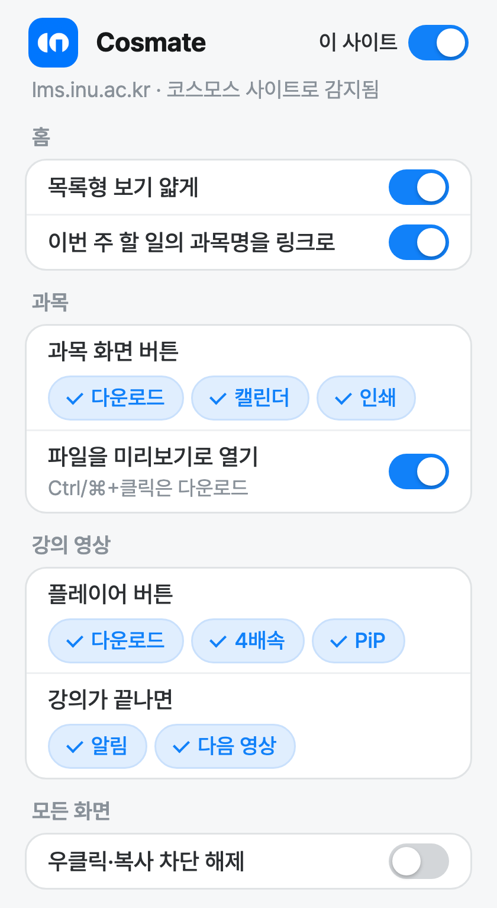

#  Cosmate

**Cosmate**는 코스모스 LXP(신버전) 기반 LMS를 조금 더 편하게 쓰기 위한 **비공식·비영리** 크롬 확장 프로그램입니다.
인천대학교 LMS(lms.inu.ac.kr)를 기준으로 만들었고, 같은 신버전 코스모스 화면을 쓰는 다른 학교 LMS도 자동으로 감지합니다.

> [!IMPORTANT]
> 이 확장은 코스모스(Coursemos)·유비온 또는 각 학교가 만들거나 배포한 것이 **아닙니다**.
> 개인이 만든 비공식 도구이며, 판매하거나 수익을 얻지 않습니다.

## 기능

팝업에서 기능마다 켜고 끌 수 있습니다.

<p align="center"></p>

**홈**
- 홈의 목록형 보기를 얇게 표시
- "이번 주 할 일"에서 과목명을 눌러 과목으로 이동

**과목**
- 파일 옆에 다운로드 버튼 표시, 주차마다 그 주차 파일 모두 받기 버튼 표시
- 파일을 미리보기 형태로 열기 (과제·게시판의 PDF 첨부파일은 새 탭에서 열림, Ctrl/⌘+클릭은 다운로드)

**강의 영상**
- 강의 영상 저장 (MP4 / MP3, 진행률·남은 시간 표시, 중간 취소 가능)
- 강의가 끝나면 알림(배지·소리)과 다음 영상으로 자동 이동
- 다 들은 강의(사이트에서 완료로 표시된 강의)는 최대 4배속까지 재생 속도 조절
- 작은 창(PiP)으로 보기

**퀴즈**
- 답안검토 화면에 인쇄 버튼 추가

**모든 화면**
- 우클릭·복사 차단 해제 (기본값: 꺼짐)

**사이트 설정**
- 코스모스 LXP 사이트를 자동으로 감지하고, 팝업에서 사이트별로 켜기/끄기 가능

## 설치

1. [Releases](../../releases)에서 최신 `cosmate-*.zip`을 내려받아 압축을 풉니다.
2. 크롬에서 `chrome://extensions`를 열고 오른쪽 위 **개발자 모드**를 켭니다.
3. **압축해제된 확장 프로그램을 로드합니다**를 누르고 압축을 푼 폴더를 선택합니다.

## 개발

소스는 TypeScript(`src/`)이고 esbuild로 `js/`에 묶습니다.

```bash
npm install
npm run build   # js/ 생성 (npm run watch로 저장할 때마다 다시 빌드)
npm run check   # 타입 검사
npm run zip     # 검사·빌드 후 dist/cosmate-v<버전>.zip 생성
```

빌드한 뒤 저장소 폴더를 **압축해제된 확장 프로그램**으로 불러오면 됩니다.

## 사용 시 주의사항

> [!WARNING]
> **우클릭·복사 차단 해제**
> - 시험·퀴즈 응시 중에는 사용하지 마세요.
> - 교수자가 복사를 막아 둔 자료는 개인 학습 용도로만 사용하세요.
> - 학칙과 부정행위 관련 규정을 지키는 것은 사용자의 책임입니다.

> [!WARNING]
> **강의 영상·파일 저장**
> - 강의 영상과 자료의 저작권은 교수자와 학교에 있습니다.
> - 저장한 파일은 개인 복습 용도로만 사용하고, 다른 사람에게 공유하거나 인터넷에 올리지 마세요.
> - 저장한 파일로 시청한 시간은 출석·진도율에 반영되지 않습니다.

출석·진도 인정 기준은 학교 규정을 따릅니다. 이 확장은 출석이나 진도를 대신 처리하지 않습니다.

## 개인정보

- 설정은 브라우저 안(`chrome.storage.local`)에만 저장됩니다.
- 사용자 정보나 이용 기록을 수집하거나 외부 서버로 보내지 않습니다.
- 네트워크 요청은 사용 중인 LMS와 그 LMS가 쓰는 콘텐츠 서버로만 보냅니다.

## 면책사항

- 이 소프트웨어는 "있는 그대로" 제공되며, 어떠한 보증도 하지 않습니다.
- 확장 사용으로 생기는 결과(학교 규정 위반, 저작권 문제, 데이터 손실 등)에 대한 책임은 사용자에게 있습니다.
- LMS가 업데이트되면 일부 기능이 예고 없이 동작하지 않을 수 있습니다.
- 사용 전에 소속 학교의 LMS 이용 규정을 확인하세요.
- 코스모스(Coursemos)와 관련 명칭·로고의 권리는 해당 회사에 있으며, 이 프로젝트는 그 회사와 관계가 없습니다.

## 라이선스

[MIT License](LICENSE)

함께 포함된 외부 라이브러리는 각자의 라이선스를 따릅니다.

| 라이브러리 | 용도 | 라이선스 |
| --- | --- | --- |
| [mux.js](https://github.com/videojs/mux.js) 6.3.0 | 영상 조각을 MP4로 변환 | Apache-2.0 |
| [lamejs](https://github.com/zhuker/lamejs) | MP3 인코딩 | LGPL-3.0 |
