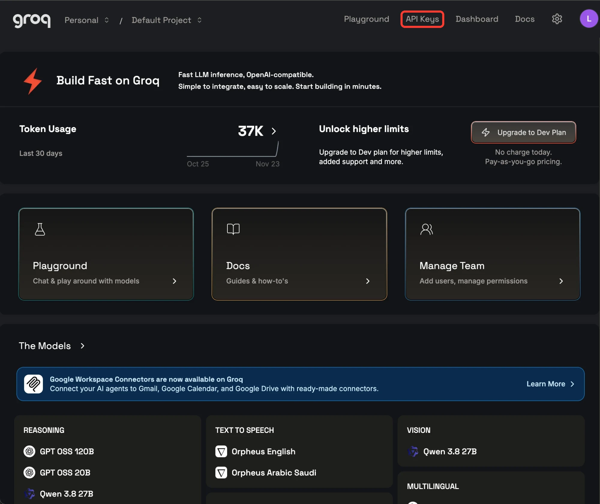
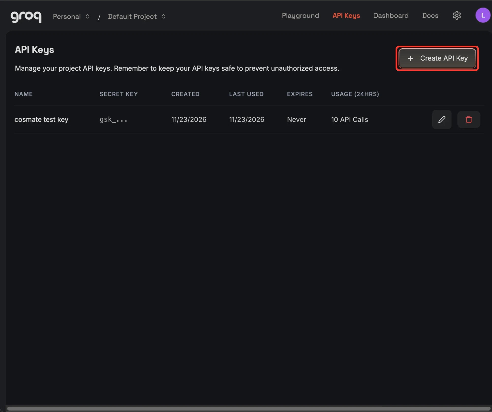
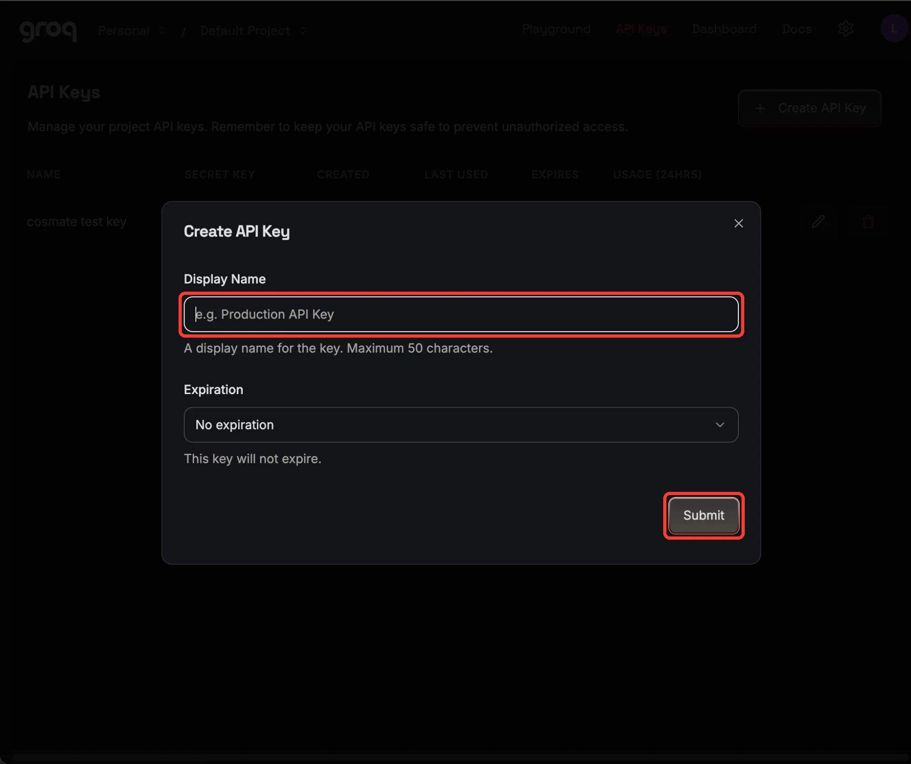
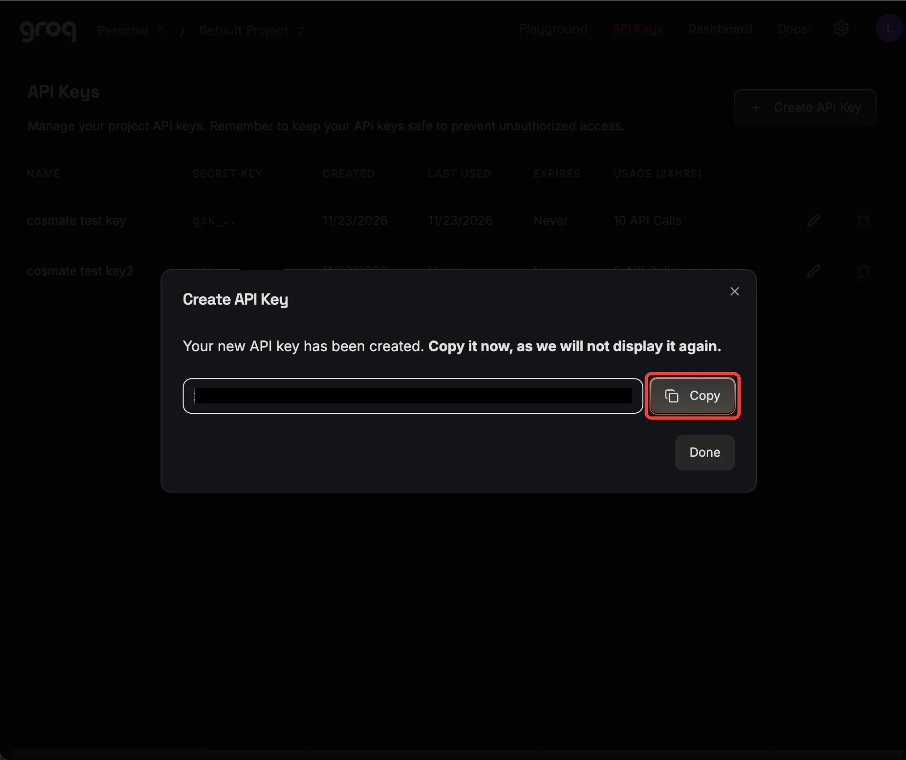

# Groq API 키 만들기 (강의 스크립트·자막용)

Cosmate의 **강의 스크립트·자막** 기능은 강의 오디오를 [Groq](https://groq.com)의 Whisper로 받아씁니다. 그래서 본인의 Groq API 키가 한 번 필요합니다.

- Groq(그록)은 AI 모델을 빠르게 돌려 주는 회사입니다.
- 무료로 만들 수 있고 카드를 등록할 필요가 없습니다.
- 스크립트·자막 기능은 GitHub 릴리스 버전(`-full.zip`)에만 있습니다.

## 1. Groq 가입·로그인

[console.groq.com](https://console.groq.com)에 들어가 Google·GitHub 계정이나 이메일로 가입하거나 로그인합니다.

## 2. API Keys 메뉴 열기

로그인하면 나오는 홈 화면 위쪽에서 **API Keys**를 누릅니다.

## 3. Create API Key 누르기

오른쪽 위의 **Create API Key**를 누릅니다.

## 4. 이름을 적고 Submit 누르기

**Display Name**에 알아보기 쉬운 이름(예: `cosmate`)을 적고, Expiration은 그대로 둔 채 **Submit**을 누릅니다.

## 5. 만들어진 키 복사하기

**Copy**를 눌러 키(`gsk_`로 시작)를 복사합니다.

> [!WARNING]
> 키는 이 창에서 **한 번만** 보입니다. 창을 닫기 전에 꼭 복사하세요. 놓쳤다면 키를 새로 만들면 됩니다.

## 6. Cosmate에 붙여넣기

1. LMS 강의 화면(또는 주차 화면·학습활동 모아보기)의 다운로드 메뉴에서 **스크립트 (TXT)**나 **자막 (SRT)**를 고릅니다.
2. "강의 스크립트 안내"를 읽고 **동의하고 계속**을 누릅니다. (다운로드를 처음 쓴다면 "강의 다운로드 안내"도 먼저 나옵니다.)
3. **Groq API 키 입력** 창에 복사한 키를 붙여넣고 **저장하고 계속**을 누릅니다.

처음 한 번만 입력하면 됩니다. 다음부터는 바로 받아쓰기를 시작합니다.

## 알아 둘 점

- **키 보관:** 키는 이 브라우저(`chrome.storage.local`)에만 저장되고 Cosmate 개발자에게는 보내지지 않습니다. 키를 다른 사람과 공유하지 마세요.
- **무료 한도:** 무료 등급에는 시간당·하루 오디오 사용량 한도가 있습니다. 한도에 걸리면 다른 모델로 넘어가고, 그래도 막히면 진행 창에 남은 시간을 보여 준 뒤 자동으로 이어서 진행합니다. 하루 한도를 다 쓰면 멈추니 다음 날 다시 시도하세요.
- **키 바꾸기:** Groq의 API Keys 화면에서 기존 키를 삭제하면, 다음에 스크립트를 만들 때 Cosmate가 새 키를 다시 묻습니다. 키가 틀렸을 때도 같은 방식으로 다시 묻습니다.
- **키가 유출됐다면:** Groq의 API Keys 화면에서 그 키를 바로 삭제하세요.
- 오디오가 어디로 전송되는지는 [README의 개인정보 항목](../README.md#개인정보)에 정리해 두었습니다.
